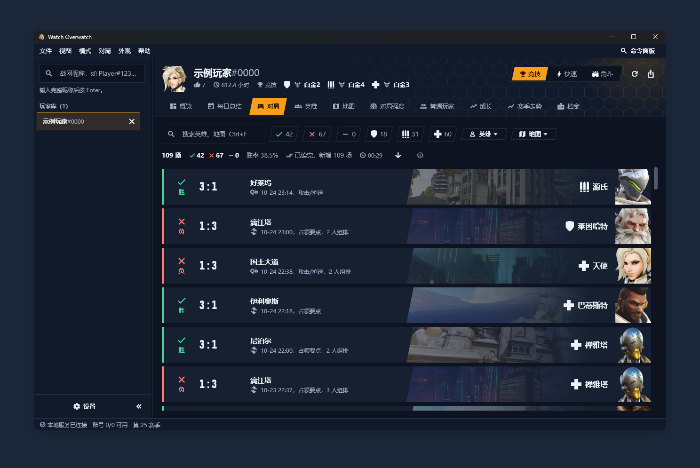

# 快速开始

十分钟从下载到第一次看到自己的对局。

## 一、下载并启动

1. 到 [发布页](https://github.com/KCN-judu/watch-overwatch/releases) 下载最新的 `watch-overwatch-v<版本>-windows-x64.zip`，解压到任意目录。压缩包里有 `watch-overwatch.exe`、`watchd.exe`、`data` 文件夹和两份说明，**它们要放在同一个目录**。
2. 双击 `watch-overwatch.exe`。窗口左下角显示“本地服务已连接”就可以用了。
3. 可选：用 `watch-overwatch-v<版本>-windows-x64.zip.sha256` 校验压缩包（SHA-256）。

## 先看示例数据（仅开发构建）

从源码运行的开发构建里，首页有“打开示例玩家”（或在搜索框输入 `示例玩家#0000`）：对局是生成的，不需要账号，也不会联网。发布包里不带示例玩家，要带上的构建方法见[命令行](cli.md#示例玩家)。

## 二、添加账号

查询玩家需要至少一个网易大神账号的 `role_id` 和 `token`。怎么拿见 [获取账号凭据](credentials.md)，设置页里也有“复制获取脚本”按钮。

打开“设置”（左下角或 Ctrl+,），在“添加或更新账号”里填名称、`role_id` 和 `token`，点“保存账号”。可以添加多个，程序会轮流使用。凭据只保存在本机。

## 三、查询玩家

在左上角搜索框输入完整的战网昵称，格式 `名字#数字`，按 Enter。第一次查询会读完这个玩家的全部历史对局并把列表先显示出来，段位和详情在后台分小批补齐；之后每次只补新的对局。查过的玩家会留在左侧的“玩家库”，重启后还在。



## 四、看什么

- **对局**：点一场看整场对局，再点一名玩家看他的个人卡片。
- **英雄**：点一个英雄看它的赛季数据、近期对局、技能和威能。
- **对局强度**：选职责和场数，点“开始分析”。
- **成长**：直接打开，看存活时长、Fleta 指数、KDA 等指标有没有变好。
- **导出**：右上角的导出按钮，选路径、模式和场数。

每个页面的细节、读数里的符号和快捷键见 [使用指引](user-guide.md)。常用快捷键：Ctrl+K 命令面板，Ctrl+1 … Ctrl+0 切换页面，F1 快捷键参考。

## 从源码构建

需要 Rust、Flutter（Windows 桌面）和 Windows SDK（用来给可执行文件嵌入图标；没有也能构建，只是没有图标）。

```powershell
cargo build --release -p watchd
cd app
flutter build windows --release
cd ..
cargo xtask package
```

`cargo xtask package` 把两步的产物打成 `dist\watch-overwatch-v<版本>-windows-x64.zip` 并写出同名 `.sha256`。验证：

```powershell
cargo fmt --all --check
cargo clippy --all-targets -- -D warnings
cargo test --workspace
cd app; flutter analyze; flutter test
```

仓库不需要 Rust 以外的脚本语言：资源同步、目录精简、打包都是 `cargo xtask` 任务，见 [命令行](cli.md)。
