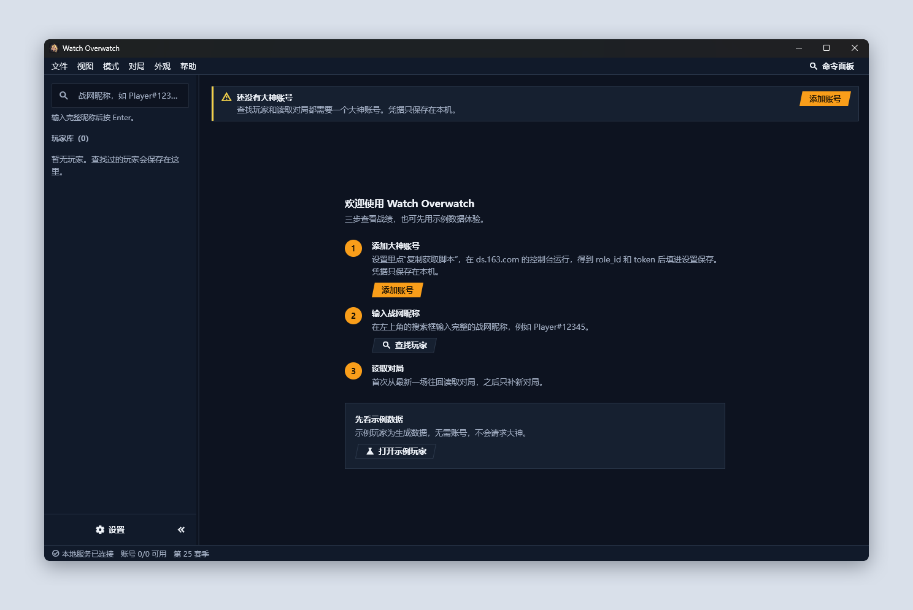
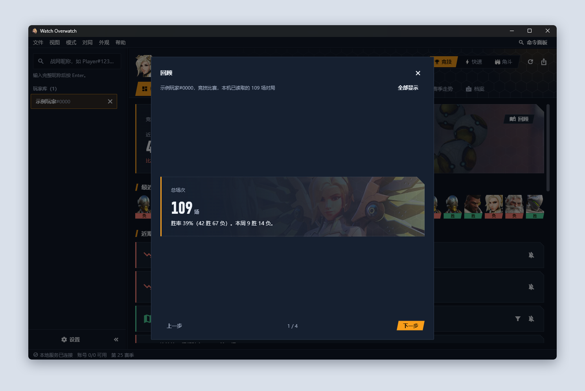
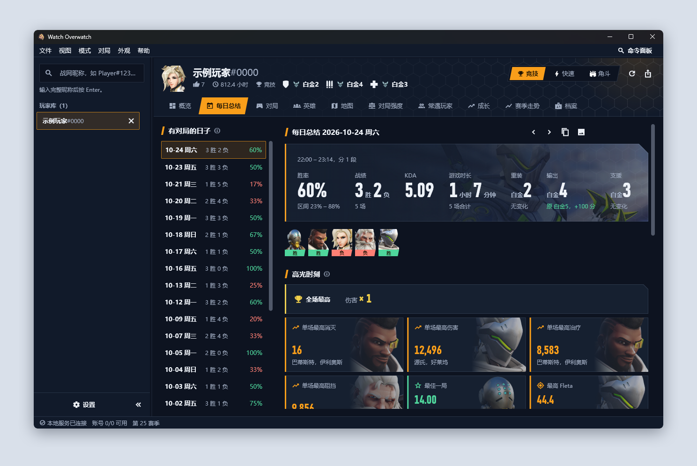
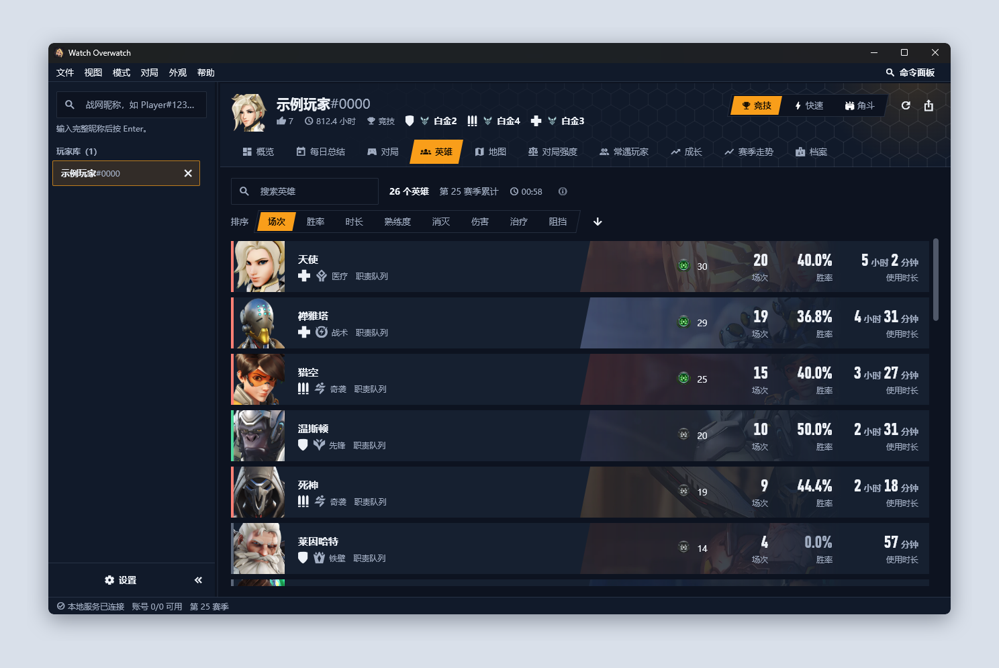

# 使用指引

## 第一次使用

1. **打开**：双击 `watch-overwatch.exe`。状态栏左下角显示“本地服务已连接”即可用。
2. **添加账号**：设置（左下角或 Ctrl+,）→“添加或更新账号”，填名称、`role_id`、`token`，点“保存账号”。`role_id` 和 `token` 用设置里的“复制获取脚本”拿，步骤见 [获取账号凭据](credentials.md)。可以加多个账号，轮流使用。
3. **查找玩家**：左上角搜索框输入完整的战网昵称（`名字#数字`），按 Enter。查过的玩家留在左侧“玩家库”，重启后还在。

账号状态在设置页和状态栏都能看到。“不可用”多半是 token 失效，重新运行脚本、用同一个名称保存即可。

**示例玩家**（只在开发构建里，发布包不带）：首次运行页的“打开示例玩家”，或搜索 `示例玩家#0000`。对局按固定规则生成，玩家名带“示例”，不向大神发请求，也不进入真实玩家的同分段基准。本页的截图都来自示例玩家。

## 窗口

- **玩家头部**：昵称、荣誉等级、游戏时长、场次、三个职责的竞技段位；右侧是模式（竞技、快速、角斗）、刷新、导出。
- **标签页**：概览、每日总结、对局、英雄、地图、对局强度、常遇玩家、成长、赛季走势、档案，Ctrl+1 … Ctrl+0 切换。
- **状态栏**：本地服务、可用账号数、当前赛季；图片加载较慢时右侧有进度条。

## 概览

打开玩家时的第一页。只用本机已读取的对局，不向大神请求；对局页读到新对局后自动更新。

| 区块 | 内容 |
|---|---|
| 页首 | 近 20 场胜率、战绩、KDA，各自和之前 20 场比（涨绿跌红）；胜率旁的小折线是每 10 场的胜率；今天的战绩。背景是最近最常用的英雄 |
| 最近 20 场 | 英雄头像加胜负条，点一场打开详情 |
| 近期动态 | 证据足够时才出现，最多 5 条（见下） |
| 常用英雄、地图 | 横条：胜率（不计平局）；细线：置信区间；竖线：总胜率。少于 5 场的变灰，不参与比较。点一行，对局页只看这个英雄或这张图 |
| 时段胜率 | 星期 × 小时的胜率，高于 50% 绿、低于 50% 红，越深偏得越多；少于 3 场的格子不着色。北京时间 |
| 与其他玩家对比 | 选一名玩家库里的玩家，同模式、同口径并排：近 20 场胜率、总胜率、KDA、场均消灭 / 阵亡 / 伤害 / 治疗和差值，写明各用多少场；场次相差三倍以上时提示 |

近期动态的几类：

- **连胜中 / 连败中**：从 3 场起；连败时对面明显更强会注明。
- **状态回升 / 状态下滑**：近 20 场比之前 20 场相差 15 个百分点以上，并列出主要来自哪张图或哪个英雄（点一下即筛选对局）。
- **强势图 / 苦手图、绝活 / 短板英雄**：胜率的置信区间整体高于或低于总胜率。
- **连续作战**：一次连着打时，从第 4 场起胜率明显下降。
- **同分段排名**：最常用英雄的某项数据在同分段同英雄里排后 25% 或前 25%。

每条右侧“屏蔽此类”，页头可全部恢复；没有就写“暂无显著动态”。判定规则见 [算法](algorithms.md) 7.3。

页首右上角的**回顾**一步步讲这段时间：总场次和本周战绩、最常用英雄、强势图（先猜后揭晓：场次够的三张图里，胜率区间下限最高的那张）、提升最大的数据（成长页里上升幅度最大的指标）、最佳一局（胜局里 KDA 最高，可直接打开）。“全部显示”排成一列，可以存成长图。

## 每日总结

一天一页（北京时间的自然日）。左边是有对局的日子和当天战绩，标题旁的 ‹ › 切换前一天、后一天。

| 区块 | 内容 |
|---|---|
| 页首 | 战绩、胜率和置信区间、场次和起止时间、分几段打、游戏时长（只算有详情的对局）、KDA；各职责段位变化（和这个职责前一场比） |
| 高光时刻 | 全场最高（当天几场的消灭 / 伤害 / 治疗 / 阻挡是全场 10 人第一）、单场最高消灭 / 伤害 / 治疗 / 阻挡、刷新本机纪录的单场（至少 20 场历史）、最长连胜（3 场起）、全场 0 阵亡、最佳一局（胜局中 KDA 最高）、最高 Fleta。点一条打开那一场 |
| 和平时比 | 当天打得最多的职责，场均数据对比近 30 天同职责，按好坏着色（阵亡越少越好） |
| 使用英雄、地图、当天对局 | 点一场打开详情 |

标题旁的“复制为图片 / 保存为 PNG”把整页存成长图，底部写明玩家、模式、日期和场数。

## 对局

一行一场：左侧竖条和图标是胜负，然后是比分、地图、时间、地图类型、组排人数，右侧是本人用的英雄。

- **筛选**：结果、职责、英雄、地图；搜索框按英雄或地图名过滤（Ctrl+F）。
- **读取**：第一次读全部历史并存在本机，之后只读比已存最新一场更新的对局。读得多时列表边读边长；读完写“已读完”，中途断开会有“继续读取”。
- **段位同步**：列表更新后，本地服务在后台给对局里的每名玩家查段位，工具栏写“段位同步中，剩余 N 场”。打开其他页面时会暂停让路，之后自动继续；重启后接着查。

### 对局详情

点一行进入。双方各 5 人：K/A/D、伤害、治疗、阻挡，数据条按全场 10 人的最大值，队内最高的一项前有 ▲。“段位”一列是读取这场对局时这名玩家本赛季的竞技段位（快照，之后不变）：

- 竞技、角斗：这一场自带的段位；
- 快速比赛：所打职责的竞技段位；这个职责没有时取其他职责里最高的，悬停注明；
- 本赛季没有段位：“未定级”；还没查到：“查询中”，查到后自动补上。

点一名玩家（或选中后按 Enter）进入他的卡片：本场数据和占本队的比例、Fleta 指数、威能、组队、点赞；本人还有这一场用过的每个英雄，角斗还有构筑。`[` `]` 在整场页切换上一场、下一场，在卡片页切换上一位、下一位；Esc 返回。

## 英雄

一个英雄一行，左侧竖条按胜率着色，少于 5 场为灰色。可以按场次、胜率、时长、熟练度，以及每 10 分钟的消灭、伤害、治疗、阻挡排序；按后四项排序时行内多显示这一项的数字。

点一行进入英雄详情，`[` `]` 切换英雄，Esc 返回。

- **赛季数据**：每 10 分钟和每场平均，见下图。
- **近期对局、技能、威能**。
- **英雄榜**：上了大神英雄榜时，标题栏写“英雄榜：某省第 N 名”，悬停看依据的场次和胜率。
- **对比**：标题栏的“对比”选另一个英雄（同职责在前），并排列出胜率（带置信区间）、KDA、游戏时间和两人都有的每项数据（每 10 分钟；比率和时长按每场）。差值 = 左 − 右，括号里是相对右边的百分比。职责不同或某个英雄不到 5 场时注明。
- **同分段对比**：本人这个英雄的中位数在段位相近、用同一英雄的其他玩家里排第几百分位，分伤害、治疗、阻挡、消灭、最后一击、阵亡（每 10 分钟；阵亡越少越好），并写明基准取自哪个段位、多少场。样本是本机存过的对局，不代表全服。本人不足 3 场或其他玩家不足 30 场时不显示。
- **构筑**（角斗领域）：代替同分段对比。每个异能和物品的选取率、通常第几回合选、选后的胜率（带置信区间和场次），以及最常见的异能组合；可在“本人”和“本机所有玩家”之间切换，少于 5 场的灰色排后。点一行列出本人用它的对局。角斗的对局详情里，“回合”一节逐回合写胜负和新选的异能、物品。

## 地图

按地图类型（运载目标、占领要点、攻击/护送、机动推进、闪点作战等，名称取自大神目录）分组。

- 每张图一行：横条是胜率，细线是置信区间，竖线是这一类的总胜率，后面是场次。少于 5 场的变灰、排后，不参与比较。
- 点一张图，右侧是详情：胜率和置信区间、战绩、平均时长（只算有详情的对局）、KDA、场均消灭 / 伤害 / 治疗，以及“本图英雄”。
- “查看本图对局”打开对局页并只看这张图；点一个英雄只看这张图上的这个英雄。
- 对局列表不分攻防，地图也不按攻防拆开。

只用本机已读取的对局。

## 对局强度

比较己方和对方的平均段位，按本人所打的职责分开看。

1. **范围**：全部（三个职责各取一份），或只看重装、输出、支援之一。只看一个职责最快，请求量约为全部的三分之一。
2. **各取最近**：5、10 或 20 场。先读有没有新对局，再从最新往前取；已存的不够会自动往更早读，全部读完仍不够就用全部。
3. **段位 / 段位分**：数字显示成“白金 2”还是“2,150”。
4. **开始分析**。第一次要查这些对局里所有玩家的段位，约一两分钟，显示分步进度，可随时取消，其他页面照常可用。

段位多半在对局页的后台同步里已经查好，分析时大多只是计算；工具栏写明发了多少次请求、多少项取自缓存。“重新分析”先读新对局，已读的走缓存；“重新查询段位”重新查玩家的段位。

结果分三块：按本人职责的汇总表、逐场走势、逐场明细。

走势图：

- 蓝：己方；红：对方。圆点是该队平均段位，实心胜、空心负。
- 竖条是该队已定级玩家的最低到最高段位，越长队内差距越大。
- 斜线阴影：中间几场没有已定级玩家，没有数据。双方都没有已定级玩家的对局仍占一个位置，工具栏写“另有 N 场没有已定级玩家”，不计入场数和平均，并往更早补够场数。
- 悬停一个点或竖条：这一队的已定级人数、段位区间、分数区间和平均分；只有其他职责段位的玩家取最高的一个，并注明人数。键盘 ←/→ 换场，↑/↓ 换队。
- 上方的“全部 / 重装 / 输出 / 支援”按本人所打的职责筛选，没打过的职责不出现。

只看本赛季的段位：本赛季没有段位的玩家算未定级，不计入。

## 常遇玩家

只统计存在本机的对局详情（对局列表本身没有阵容）。组排来自对局里的组队信息。

- **组排与单排**：同队里至少一人和本人组队算组排，否则算单排；各自的胜率和置信区间。
- **常遇玩家**：在本人已存对局里出现 2 次以上的玩家，按共同场次排：同队几场、胜率，对面几场、胜率，组排几场，最近一次。胜率都是本人的。
- **共同对局**：点一位玩家，右侧列出和他的共同对局（结果、时间、地图、同队或对面、是否组排、双方英雄和 K/A/D），上方对比本人和他同队时、其他对局、和他对面时的胜率。点一场打开详情。

只列发生过的事，不给玩家贴标签。存过详情的组排对局，在对局列表里写“N 人组排”。

## 成长

页首一排卡片，每个指标一张：“治疗量 上升”“KDA 下降”“存活时长 无明显趋势”，第二行是“前后半段 +21%，显著”（后半段均值比前半段，以及 显著 / 弱趋势 / 无变化）。悬停看 p 值和前后均值。下面是各指标的折线图：一个点一局，粗线是最近 10 局的平均，空心点是负局。

- 数据来自存到本机的对局详情；还没存的在页首注明，准备好后自动算进来（F5 重新读取）。
- “全部 / 重装 / 输出 / 支援”只看某个职责。不同职责的数值本来就不同，以分职责的结果为准。
- 不足 2 分钟的对局不计入；不足 8 场不检验趋势。

| 指标 | 口径 |
|---|---|
| 存活时长 | 对局时长 ÷ 阵亡次数。大神只给阵亡次数、不给时间点，所以是平均值，含复活等待。0 阵亡的对局取整局时长，用盾牌标出 |
| Fleta 指数 | 每局的值，见 [指标口径](metrics.md) |
| KDA | （消灭 + 助攻）÷ 阵亡；0 阵亡按 1 算，用盾牌标出 |
| 治疗量、阻挡量 | 每 10 分钟的量（治疗含自我治疗）。治疗只算支援对局，阻挡只算重装对局；当前职责没有这一项时不画 |

**对比前一段**：最近一段（总场数的一半，最多 30 场）和之前同样多的一段逐场对齐。横轴：段内第几场；实线：最近一段；虚线：之前一段。每张图上方写两段平均值、哪段高、高多少和各自场数；两段各不足 5 场不比。

## 赛季走势

最近几个赛季各职责的胜率和段位。只有一个赛季的数据时不画折线，每个职责一张数字卡片。

- **段位轨迹**：每个职责一条阶梯线，是本机存过的竞技对局里每场结束时的段位分，空心点是负局。虚线是赛季分界：对局列表不带赛季，分界按各赛季的生涯场次从最新一场往回数，是推算值。指着一场时点一下（或 Enter）打开这场。
- **掉分时对面强不强**：最近几段连续掉 100 分以上的区间，写明掉了多少、几胜几负，以及其中算过对局强度的几场里对面平均比己方高（或低）多少分。

## 档案

身份、近期表现（来自已读取的对局，场均伤害 / 治疗 / 阻挡旁是全服平均）、本赛季各职责的生涯数据，以及行为与荣誉、省榜排名（大神有数据时才显示）。

## 分享图片

- **复制为图片 / 保存为 PNG**：概览的常用英雄、地图、时段胜率，地图页的每类地图，成长页的每张图，每日总结整页，回顾。图片是当前主题下的样子，底部写明玩家、模式、用了多少场本机对局；不含凭据。复制走 Windows 的图片剪贴板，可直接粘贴到聊天软件；失败时改用保存。
- **隐藏昵称**：设置 → 外观 →“图片里隐藏玩家昵称”，打开后图片和回顾里的昵称显示为“玩家”。

## 导出

Ctrl+E 或头部右侧的导出按钮，导出当前玩家的数据集（JSON）。对话框里选：

- **模式**：可多选，或“全部模式”；
- **对局数量**：每个模式取最近 20、50、100、全部，或输入 1–5000，默认全部；
- **同时导出玩家段位**：每名玩家的竞技段位，用于对局强度；首次要逐个查询，每场约多 7 秒，查过的直接复用。

点“开始导出”后先选保存位置（默认名“玩家名-数据集.json”），取消则什么都不读不写。之后读取对局列表和详情（本机已有的直接用，其余约每场 1 秒），状态栏显示进度，可取消，最后写文件。导出里没有 token 和任何凭据。格式见 [导出格式](export.md)。

## 版本更新

启动后在后台查一次 GitHub 上有没有新版本（设置 → 版本更新 → 自动检查更新，可关），也可以从菜单“帮助 → 检查更新…”手动查。有新版时状态栏右下角出现“新版本 x.y.z”。

“下载更新”→ 校验通过后“重启并更新”：应用关闭，替换程序目录里的文件，再打开新版本。账号、对局库、界面状态在 `%LOCALAPPDATA%\Watch Overwatch\`，不受影响。检查更新只访问本项目公开的发布页，不发送账号或对局数据。

更新失败时重新打开原版本，原因记在 `%LOCALAPPDATA%\Watch Overwatch\updates\update.log`，可到发布页下载 zip 手动覆盖。开发构建只提示，不自动安装。

## 读数里的符号

每个数字的定义、算法和局限见 [指标口径](metrics.md)；界面上指标旁的 ⓘ 点一下打开对应的一节，悬停只看说明。用词见 [术语表](glossary.md)。

| 看到的 | 意思 |
|---|---|
| `—` | 没有数据。英雄数据里表示这个英雄不产出这一项（比如重装没有治疗） |
| 灰色的 `0` | 这个英雄能产出，但大神没有记录，按 0 计 |
| `≈ 12.3` | 不是大神直接给的：由每场平均推算，或取自本机已读取的对局 |
| 灰色的胜率 | 少于 5 场，只列出不比较 |
| ▲ | 同队里这一项最高（并列都标） |
| 数据条 | 伤害红、治疗绿、阻挡蓝，长度按全场最大值 |

## 快捷键

| 命令 | 键 |
|---|---|
| 命令面板 | Ctrl+K |
| 查找玩家 | Ctrl+L |
| 概览、每日总结、对局、英雄、地图、对局强度、常遇玩家、成长、赛季走势、档案 | Ctrl+1 … Ctrl+9、Ctrl+0 |
| 竞技、快速、角斗 | Alt+1 / 2 / 3 |
| 刷新 | F5 |
| 导出数据集 | Ctrl+E |
| 筛选当前列表 | Ctrl+F |
| 上一场或上一位 / 下一场或下一位 | `[` / `]` |
| 返回 | Esc 或 Alt+← |
| 折叠左侧玩家库 | Ctrl+B |
| 切换左右窗格 | F6 / Shift+F6 |
| 设置 | Ctrl+, |
| 快捷键参考 | F1 |

列表里方向键移动，Enter 打开，Home、End、PgUp、PgDn 翻动。

## 常见问题

**“还没有大神账号”或账号不可用**：到设置里添加或更新账号。token 一栏留空保存不会保留旧值，要重新粘贴。

**找不到玩家**：昵称要完整，含 `#` 和数字。资料设为私密的玩家读不到对局。提示“大神返回成功，但没有数据（账号验证已通过）”时，账号是好的，是大神对这次查找什么都没返回：查过的玩家也这样时，多半是大神的玩家查询暂时不可用，稍后再试。

**对局强度提示“没有可计算强度的对局”**：这些对局里没有一名玩家能确定段位。快速比赛要参与者本赛季有竞技段位。

**分析很慢**：第一次要查很多玩家（每场约 10 人）。先把范围选成一个职责、取 5 场；大神有限速，程序快不了。之后走缓存，快很多。

**缓存多大、怎么清**：设置 →“数据与本地服务”→“本地缓存”，写明对局记录、详情（含段位快照）、队友与对手各有多少；“清除缓存”后从头重新读取。缓存只在本机，不含凭据。

**英雄数据里很多 `—` 或 `≈`**：大神对打得少的英雄会漏项，程序按规则补全，规则见 [算法](algorithms.md)。

**图片不显示或一直是灰块**：图片来自外部地址，网络不通时显示灰块，不影响数据。缓存在 `%LOCALAPPDATA%\Watch Overwatch\img-cache\`，删掉会重新下载。

**界面布局乱了**：设置 →“重置界面布局”。
