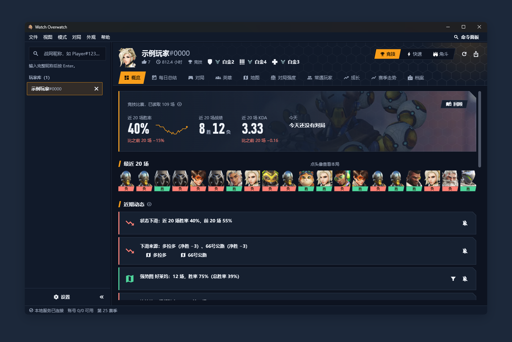
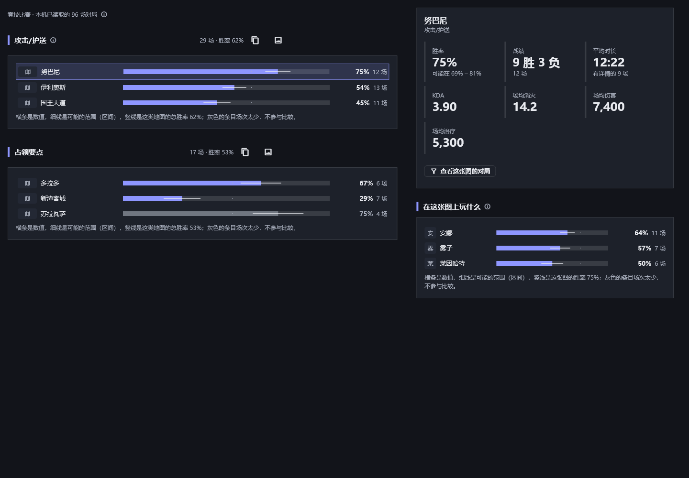
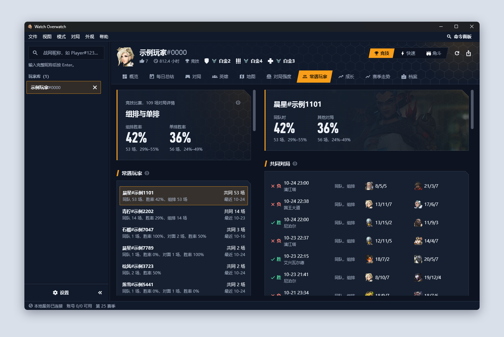

# 使用指引

## 第一次使用

1. **打开程序**：双击 `watch-overwatch.exe`。窗口左下角显示“本地服务已连接”就可以用了。
2. **添加账号**：查询玩家需要至少一个大神账号，role_id 和 token 怎么拿见 [获取账号凭据](credentials.md)。打开“设置”（左下角或 Ctrl+,），在“添加或更新账号”里填名称、role_id 和 token，点“保存账号”。可以添加多个，程序会轮流使用。
3. **查找玩家**：在左上角搜索框输入完整的战网昵称，格式 `名字#数字`，按 Enter。查过的玩家会留在左侧“玩家库”，重启后还在。

账号状态在设置页和窗口底部都能看到。显示“不可用”通常是 token 失效，重新粘贴一个即可。

还没有玩家时，主区域按这三步引导，已完成的一步打勾。**先看示例数据**：点“打开示例玩家”（或搜索 `示例玩家#0000`），不需要账号就能浏览每个页面。示例玩家的对局都是按固定规则生成的，玩家名都带“示例”，本地服务直接回答，不会向上游发任何请求；示例对局只和示例对局互相比较，不会进入真实玩家的同侪基准。不用了可以在玩家库里移除。

## 窗口结构

- **顶部**：玩家名、荣誉等级、时长和场次、三个职责的竞技段位；右侧切换模式（竞技、快速、角斗），以及刷新和导出。
- **标签页**：对局、英雄、对局强度、成长、赛季走势、档案。
- **底部状态栏**：服务状态、账号数、当前赛季；图片加载慢的时候会出现一条进度。

## 各页面

### 概览

打开一名玩家时的第一页，一屏说清这名玩家最近怎么样。只用本机已经读取的对局计算，不向上游请求，打开就有；对局页读到新对局后会自动更新。

- **页首**：近 20 场胜率（和之前 20 场比，涨了绿色、跌了红色；右边的小折线是每 10 场的胜率）、近 20 场战绩、KDA、今天的战绩。背景是这名玩家最近最常用的英雄。
- **最近 20 场**：一排英雄头像，下面一条写着胜 / 负；点一场直接打开它的详情。
- **与其他玩家对比**：页面最下方，选一名这次查过的其他玩家，同模式、同口径（都只用本机已读取的对局）并排列出近 20 场胜率、总胜率、KDA、场均消灭 / 阵亡 / 伤害 / 治疗和差值，并写明双方各用了多少场；场次相差三倍以上时提示。
- **值得注意**：只在证据足够时出现，最多 5 条。例如连胜或连败 3 场（连败时如果对面明显更强会写明）、近期胜率比之前变了 15 个百分点以上以及主要是哪张地图或哪个英雄带来的（点一下即筛选对局列表）、某张地图或某个英雄胜率的整个可能范围都高于或低于总胜率、一次连着打时从第 4 场起明显变差、最常用英雄的某项数据在同段位同英雄里排后 25% 或前 25%。每条右侧可以“不再提示这类”，页头可全部恢复。没有发现就写“目前没有足够明确的发现”。规则见 `docs/algorithms.md` 7.3。
- **常用英雄、地图**：横条是胜率（不计平局），细线是可能的范围，竖线是总胜率；少于 5 场的变灰，只列出不比较。点一行，对局页只显示这个英雄或这张地图的对局。
- **什么时候打得好**：星期 × 小时的胜率，比 50% 高是绿色、低是红色，越深离得越远；少于 3 场的格子不着色。时间按北京时间。

### 对局

每一行是一场：左边竖条和图标表示胜负，中间是比分、地图、时间和模式，右侧是该玩家用的英雄。点一行进入详情。

- **筛选**：按结果、职责、英雄、地图；搜索框可以输入英雄或地图名（Ctrl+F）。
- **读取范围**：默认读取全部对局，并保存在本机。以后每次打开只读取比已保存的最新一场更新的对局，没有新对局时几乎立刻完成。读取较多时列表会一边读一边增长，工具栏会写“正在读取更早的对局…”；读完显示“已读完”，没读完（比如中途断网）会有“继续读取”。
- **详情**：分两页。第一页是整场：双方各 5 人，列出 K/A/D、伤害、治疗、阻挡，数据条的长短按全场 10 人的最大值，每项的队内最高值前有 ▲；“段位”一列：竞技、角斗显示这一场的段位，快速比赛显示该玩家当前的竞技段位（鼠标移上去会注明不是当时的，只有其他职责的段位时取其中最高的），查不到的显示 —。打开时表先出来，段位还没查完的格子写“查询中”，查完自动补上。点一名玩家（或选中后按 Enter）进入第二页：他的详情页，用卡片排列：本场数据（占本队的比例）、**Fleta 指数**、威能、组队、点赞，查询对象还有他用过的每个英雄；角斗还有构筑。`[` 和 `]` 在整场页切换上一场、下一场，在玩家页切换上一位、下一位；Esc 返回上一页。

### 英雄

每个英雄一行，左边竖条按胜率上色（场次少于 5 场时是灰色，因为样本太少）。

- **排序**：上方可按场次、胜率、时长、熟练度，以及每 10 分钟的消灭、伤害、治疗、阻挡排序。选了后四项时，每一行会多显示这一项的数字。
- **点开**：进入这个英雄的详情页：赛季数据、用这个英雄打的近期对局、技能和威能。`[` 和 `]` 切换上一位、下一位，Esc 返回。
- **英雄榜**（英雄详情）：这个英雄上了大神英雄榜时，标题栏写“英雄榜：某省第 N 名”，鼠标停留看上榜依据的场次和胜率。
- **对比两个英雄**（英雄详情）：标题栏的“对比”选另一个英雄（同职责的排前面），并排显示两人的胜率（带可能的范围）、KDA、游戏时间，以及两个英雄都有的每项数据（每 10 分钟；比率和时长用每场），差值是左减右并附相对右边的百分比。职责不同、或某个英雄不到 5 场时会写明。
- **同侪对比**（英雄详情）：该玩家用这个英雄的典型一场，在差不多段位、用同一英雄的其他玩家里排第几百分位，分伤害、治疗、阻挡、消灭、最后一击、阵亡（每 10 分钟；阵亡越少越好）。下面写明基准取自哪个段位、多少场。样本来自本机存过的对局，不代表全服。该玩家这个英雄不到 3 场，或同侪不到 30 场时不显示。
- **构筑**（英雄详情，角斗领域）：同侪对比换成构筑统计：每个异能和物品的选取率、通常在第几回合选、选了之后的胜率（带范围和场次），以及最常见的异能组合。可在“该玩家”和“本机所有玩家”之间切换；少于 5 场的条目变灰排在后面。点一行列出该玩家用它的对局，点一场即打开。角斗领域的对局详情里，“回合”一节逐回合写出该回合胜负和该玩家新选的异能、物品。

### 地图

按地图类型（运载目标、占领要点、攻击/护送、机动推进、闪点作战等，名称取自大神目录）分组，每类下列出该玩家打过的地图：

- 每张图一行：胜率横条、可能的范围、分出胜负的场次；竖线是这一类地图的总胜率。少于 5 场的地图变灰，排在后面，不参与比较。
- 点一张图，右侧显示它的详情：胜率和范围、战绩、平均时长（只算打开过详情的对局）、KDA、场均消灭 / 伤害 / 治疗，以及“在这张图上玩什么”：这张图上最常用的英雄和各自的胜率。
- “查看这张图的对局”打开对局页并只看这张图；点英雄则只看这张图上的这个英雄。
- 对局列表不区分进攻和防守，所以地图不按攻防拆开。

只用本机已读取的对局计算，对局页读到更多对局后自动更新。

### 对局强度

比较“己方”和“对方”的平均段位，并且按该玩家自己打的职责分开看。

1. 选“范围”：全部（三个职责各取一份），或者只分析重装、输出、支援中的一个。只选一个职责最快，请求量大约是全部的三分之一。
2. 选取最近 5、10 或 20 场：每个职责取最近这么多场。程序先看有没有新对局，有就读进来，再从最新的往前取；只选一个职责，就取这个职责的最近这么多场。已保存的不够会自动往更早读；读完了仍不够，就取全部。
3. 选“段位”或“段位分”：决定数字显示成“白银3”还是“1,420”。
4. 点“开始分析”。程序会读取这些对局里所有玩家的段位，第一次需要一两分钟，页面会显示每一步的进度，可以随时取消，期间其他页面照常使用。

启动后，上次看的玩家的对局会先从本机直接显示出来，再去上游确认有没有新对局，所以几乎不用等。

为了不让分析时一次等太久，程序会在对局列表更新后，在后台把最新对局里玩家的段位一小批一小批查好（对局页工具栏会写“正在准备对局数据”）。查好的数据存在本机，所以分析时多数只是计算。

分析过的内容会存在本机：再次分析，或者换一个范围，已经读过的对局和玩家直接用缓存，通常几秒就完成。结果上方会写“缓存 N”，表示有多少项没有请求上游。每次分析都会先检查有没有新打的对局；“强制刷新”还会重新查询玩家的当前段位（对局详情仍用缓存）。
4. 结果分三块：按该玩家所打职责的汇总表；逐场走势图；逐场明细表。

走势图怎么看：

- 蓝色是己方，橙色是对方，圆点是该队的平均段位；实心点是胜，空心点是负。
- 竖条是该队已评定玩家里最低到最高的段位，条越长，队内差距越大。
- 斜线阴影表示中间有几场没有任何已评定的玩家，这几场没有数据。双方都没有已评定玩家的对局不会消失，仍然占一个位置，工具栏里写“另有 N 场无人定级”，它们不计入场数和平均，程序会再往更早的对局补够 N 场。
- 鼠标移到己方或对方的点（或竖条）上，会显示这一队的已评定人数、段位区间、分数区间和平均分。已评定指玩家有竞技段位；他只有别的职责的段位时，取其中最高的，并在提示里注明有几人；键盘用 ←/→ 换场，↑/↓ 换队。
- 上方的“全部 / 重装 / 输出 / 支援”是按该玩家自己打的职责筛选对局，没打过的职责不会出现。

### 常遇玩家

只统计存在本机的对局详情（对局列表本身没有阵容），组排来自对局里的好友组队信息。

- **组排与单排**：同队里至少有一人和该玩家组队算组排，否则算单排，各自的胜率和可能的范围。
- **常遇玩家**：在该玩家已存的对局里出现 2 次及以上的玩家，按共同场次排，写明同队几场、胜率多少，对面几场、胜率多少，组排几场，最近一次是什么时候。胜率都是该玩家的胜率。
- **共同对局**：点一位玩家，右侧列出和他的共同对局：结果、时间、地图、同队还是对面、是否组排、双方的英雄和消灭/阵亡/助攻；上方对比该玩家和他同队时、其他对局、和他对面时的胜率。点一场打开详情。
- 页面只列出发生过的事，不给任何玩家贴标签。对局页的对局卡片上，存过详情且是组排的对局会写“N 人组排”。

### 成长

页首一排卡片，每个指标一张，写“保活能力呈现上升趋势”“治疗量没有明显趋势”这样的结论，下面是 p 值（鼠标移上去看较早一半和较新一半的平均值对比）；卡片下面一行说明 p 值（Mann-Kendall 趋势检验的双侧 p 值，p < 0.1 判定存在趋势）。然后是各指标的折线图：一个点是一局，粗线是最近 10 局的平均，空心点是败局。数据来自已经存到本机的对局详情，打开很快；还没存到本机的对局会在页首注明，后台准备好后自动算进来（按 F5 重新读取）。页首的“全部 / 重装 / 输出 / 支援”切换只看某个职责；不同职责的数值本来就不一样，换职责会让“全部”变化，所以以分职责的结果为准。不足 2 分钟的对局不计入，不到 8 场不下结论。

- **存活时长**：每次阵亡之间平均隔多久 = 对局时长 ÷ 阵亡次数。上游只给阵亡次数，不给每次阵亡的时间点，所以只能平均着算，含重生等待。没有死亡的对局取整局时长（实际只会更长），用盾牌标出，背后的底色填满这一局。读数里写“对局时长”和阵亡次数。
- **Fleta 指数**：见“对局”一节；这里是每局的值。
- **KDA**：（消灭 + 助攻）÷ 阵亡，没有死亡的按 1 次阵亡算，同样用盾牌标出。
- **治疗量、阻挡量**：每 10 分钟的量（治疗含自我治疗），长短不同的对局可以比；治疗量只算打辅助的对局，阻挡量只算打重装的对局。当前职责没有这项数据时不画这张图。
- **对比前一段**：页首的“对比前一段”把最近一段（总场数的一半，最多 30 场）和它之前同样多的一段逐场对齐：横轴是这一段里的第几场，实线是最近一段，虚线是之前一段，两条线同一纵轴。每张图上方写两段的平均值、哪段高、高多少，以及各自的场数。两段各不到 5 场时不比。

### 赛季走势

最近几个赛季各职责的胜率和段位。只读到一个赛季时不画折线，改为每个职责一张数字卡片。

- **段位轨迹**：页面最上方，每个职责一条阶梯线，是本机存过的对局里每一场结束时的段位分；空心点是输掉的。虚线是赛季分界，标着赛季号。对局列表本身不带赛季，分界是按各赛季的生涯场次从最新一场往回数出来的，所以是推算。鼠标指着一场时再点一下（或按 Enter）打开这场对局。
- **掉分时对面强不强**：最近几段连续掉了 100 分以上的对局，写明掉了多少、几胜几负，以及其中算过对局强度的几场里对面平均比我方高（或低）多少分。

### 档案

身份信息、近期表现（来自已读取的对局）、各职责的生涯数据，以及行为与荣誉、省榜排名（有数据时才显示）。

## 分享图片与回顾

- **复制 / 保存图片**：概览的常用英雄、地图、胜率热力图，地图页的每类地图，成长页的每张图，标题右侧都有“复制为图片”和“保存为 PNG”。图片是这一块在当前主题（亮或暗）下的样子，底部一行写明玩家、模式、用了多少场本机对局，以及 Watch Overwatch；不含任何凭据。复制用的是 Windows 自带的图片剪贴板，可以直接粘贴到聊天软件里；失败时改用保存。
- **隐藏昵称**：设置 → 外观里的“图片里隐藏玩家昵称”打开后，图片和回顾里的玩家昵称显示为“玩家”。
- **回顾**：概览页右上角的“回顾”一步一步讲这段时间：打了多少场、胜率和本周战绩，最常玩的英雄，最强的地图（先猜一猜再揭晓：在场次够的三张图里，胜率区间下限最高的那张），进步最大的一项（成长页里趋势向上、幅度最大的指标），最好的一局（赢下的对局里 KDA 最高的，可直接打开）。“全部显示”把所有步骤排成一列，可以存成一张长图。

## 读数里的符号

每个数字的定义、算法和局限见 [指标口径](metrics.md)；界面上指标旁的 ⓘ 点一下就打开对应的那一节（鼠标停留只看说明）。用词见 [术语表](glossary.md)。

| 看到的 | 意思 |
|---|---|
| `—` | 没有数据。在英雄数据里，表示这个英雄无法产出这一项（比如重装没有治疗） |
| `0`（灰色） | 这个英雄能产出，但上游没有记录，按 0 计 |
| `≈ 12.3` | 不是上游直接给的：由每场平均推算，或取自本机已读取的对局 |
| 灰色的胜率 | 场次太少（少于 5 场），仅供参考 |
| ▲ | 该项在同队里最高（并列时都标） |
| 数据条 | 伤害红、治疗绿、阻挡蓝；长度按全场最大值 |

## 快捷键

| 命令 | 键 |
|---|---|
| 命令面板 | Ctrl+K |
| 查找玩家 | Ctrl+L |
| 概览、对局、英雄、地图、对局强度、常遇玩家、成长、赛季走势、档案 | Ctrl+1 … Ctrl+9 |
| 竞技、快速、角斗 | Alt+1 / 2 / 3 |
| 刷新 | F5 |
| 导出数据集 | Ctrl+E |
| 筛选当前列表 | Ctrl+F |
| 上一场或上一位 / 下一场或下一位 | `[` / `]` |
| 返回 | Esc 或 Alt+← |
| 折叠左侧玩家库 | Ctrl+B |
| 切换左右窗格 | F6 / Shift+F6 |
| 设置 | Ctrl+, |
| 快捷键参考 | F1 |

列表里用方向键移动，Enter 打开，Home、End、PgUp、PgDn 翻动。

## 导出

Ctrl+E 导出当前玩家的数据集（JSON）。先在对话框里选三样：**模式**（可多选，也可以点“全部模式”一次选满）、**对局数量**（每个模式取最近的：20、50、100、全部，或自己输入 1–5000；默认是全部）、是否**同时导出玩家段位**（每名玩家的竞技段位，用于对局强度；第一次要逐个查询，每场约多花 7 秒，查过的下次直接用）。每场对局都带双方玩家的数据。点“开始导出”后弹出系统的“另存为”对话框，保存位置和文件名由你自己定（默认名是“玩家名-数据集.json”）；取消对话框就不会读取也不会写入。

导出会先读取对局列表、再把这些对局一小批一小批准备好（本机已有的直接用，没有的才向上游读取，约每场 1 秒），状态栏显示进度，可随时取消，最后才写文件。导出里不含 token 和任何凭据。格式见 [export.md](export.md)。

## 常见问题

**提示“还没有大神账号”或账号不可用**：到设置里添加或更新账号。token 留空不会保留旧值，需要重新粘贴。

**找不到玩家**：确认昵称完整，包含 `#` 和数字。资料设为私密的玩家读不到对局。

**对局强度提示“没有可计算强度的对局”**：这些对局里没有任何一名玩家能确定段位。快速比赛需要参与者有竞技段位。

**分析很慢**：第一次分析要查很多玩家（约每场 10 人）。可以先把范围选成一个职责、取 5 场；上游有限速，程序不会更快。之后再分析会用缓存，快很多。

**缓存占多大、怎么清**：在设置页“数据与本地服务”里看“本地缓存”（对局记录、详情、队友与对手、玩家段位各有多少），点“清除缓存”即可，清除后会从头重新读取。缓存只在本机，不含任何凭据。

**英雄数据里很多项是 `—` 或 `≈`**：上游对打得少的英雄会漏项，程序按规则补全，规则见 [算法文档](algorithms.md)。

**图片不显示或一直是灰块**：图片取自外部地址，网络不通时显示灰块，不影响数据。缓存在 `%LOCALAPPDATA%\Watch Overwatch\img-cache\`，删掉后会重新下载。

**界面布局乱了**：设置里“重置界面布局”。
